<p align="center">
  
</p>

<p align="center">
  <a href="https://github.com/kshyatisekhar-panda/claude-seo-kit/releases"></a>
  <a href="LICENSE"></a>
  
  
</p>

# Claude SEO Kit

An SEO toolkit for [Claude Code](https://claude.com/claude-code). Point it at a
website and it crawls, checks 75 things across six areas, scores each one, and
tells you what to fix first. Then it can fix the issues in your code, keep them
from coming back in CI, and turn the results into a branded report.

## Install

Inside Claude Code:

```
/plugin marketplace add kshyatisekhar-panda/claude-seo-kit
/plugin install claude-seo-kit@claude-seo-kit
/seo-kit setup
```

You need Python 3.10 or newer. Setup creates a private environment in
`~/.claude-seo-kit` with four small packages (requests, urllib3,
beautifulsoup4, defusedxml). Nothing is installed globally. `/seo-kit doctor`
checks the install.

## Use

```
/seo-kit audit https://example.com
```

| Command | What it does |
|---|---|
| `/seo-kit audit <url>` | Crawl the site, score six areas, get a prioritized plan |
| `/seo-kit page <url>` | Everything about one page, with fixes |
| `/seo-kit technical <url>` | Indexability, canonicals, redirects, HTTPS, hreflang, robots.txt |
| `/seo-kit sitemap <url>` | Check or generate XML sitemaps |
| `/seo-kit schema <url>` | Validate or write structured data (JSON-LD) |
| `/seo-kit content <url>` | Content quality and trust (E-E-A-T) |
| `/seo-kit local <url>` | Local business SEO and Google Business Profile |
| `/seo-kit ai <url>` | Visibility in ChatGPT, Claude, Perplexity and Google AI answers |
| `/seo-kit fix` | Apply the fixes in your code: Next.js, Astro or plain HTML |
| `/seo-kit migrate` | Move or restructure a site without losing traffic |
| `/seo-kit refresh <site>` | Pages losing clicks, why, and what to update |
| `/seo-kit ci run\|setup` | Fail the build when SEO breaks, locally or as a GitHub Action |
| `/seo-kit report` | Branded HTML or PDF report for clients or your team |
| `/seo-kit logs <file>` | How Googlebot and AI crawlers really crawl your site |
| `/seo-kit video` | Video SEO for web pages and YouTube |

## What the audit checks

| Area | Examples |
|---|---|
| Technical | Status codes, noindex, canonicals, redirect chains, HTTPS and host duplicates, hreflang, robots.txt, sitemaps, broken internal links, duplicate titles |
| Content | Titles and descriptions, headings, thin pages, alt text, authors and dates, about and contact pages |
| Structured data | JSON syntax, Google's required and recommended properties per type, retired types |
| Performance | Real-user Core Web Vitals from PageSpeed Insights, lazy-loaded hero images, unsized images |
| AI search | AI crawler access by purpose, content that needs JavaScript, quotable structure |
| Local | LocalBusiness markup, address completeness, phone consistency, map links |

## The tools on their own

Everything runs through one script, which you can also use without Claude:

```
python run.py audit https://example.com -o audit.json
python run.py page https://example.com/pricing --psi
python run.py robots https://example.com --test / /blog/
python run.py ci --dir out --base-url https://example.com
python run.py -h
```

## Safety

- Every request is checked: private, internal and cloud metadata addresses are
  refused, and each connection goes to exactly the address that was checked.
- The crawler stays on your host and respects robots.txt.
- Sitemaps are parsed with XML entity expansion disabled.
- Fetched pages are treated as data, never as instructions to Claude.

## License

MIT. See [LICENSE](LICENSE).
